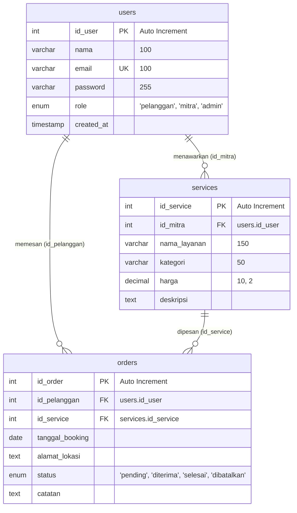
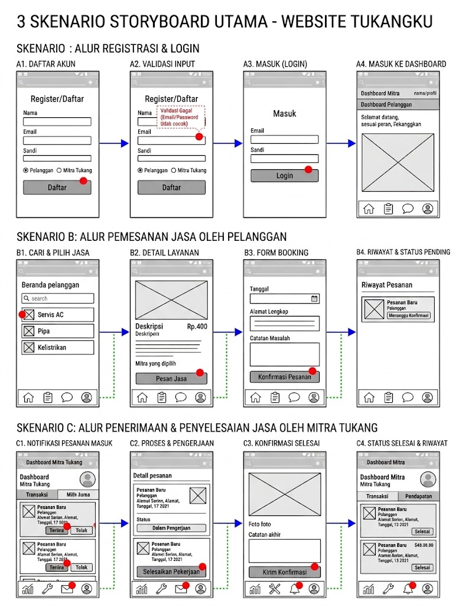
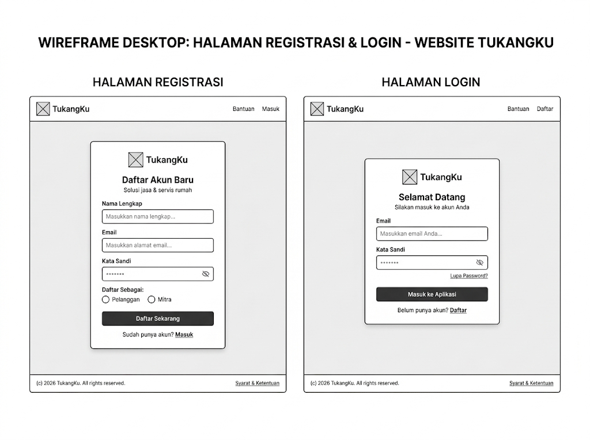
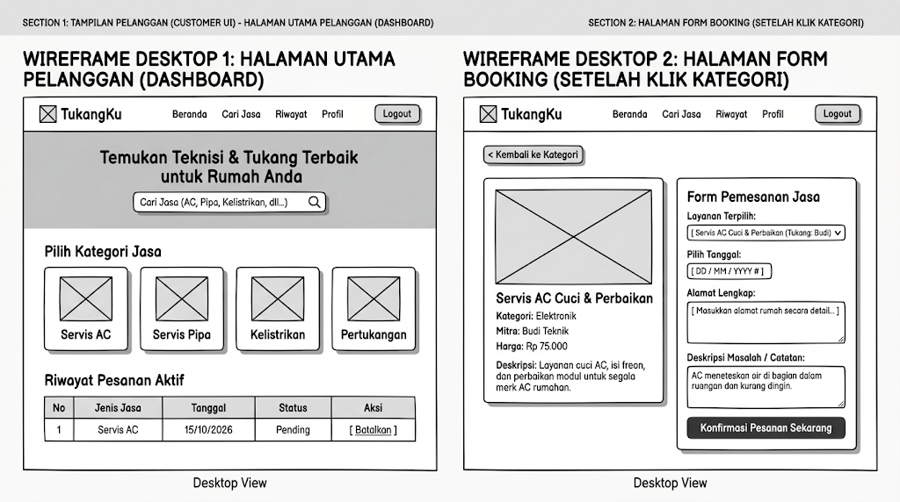
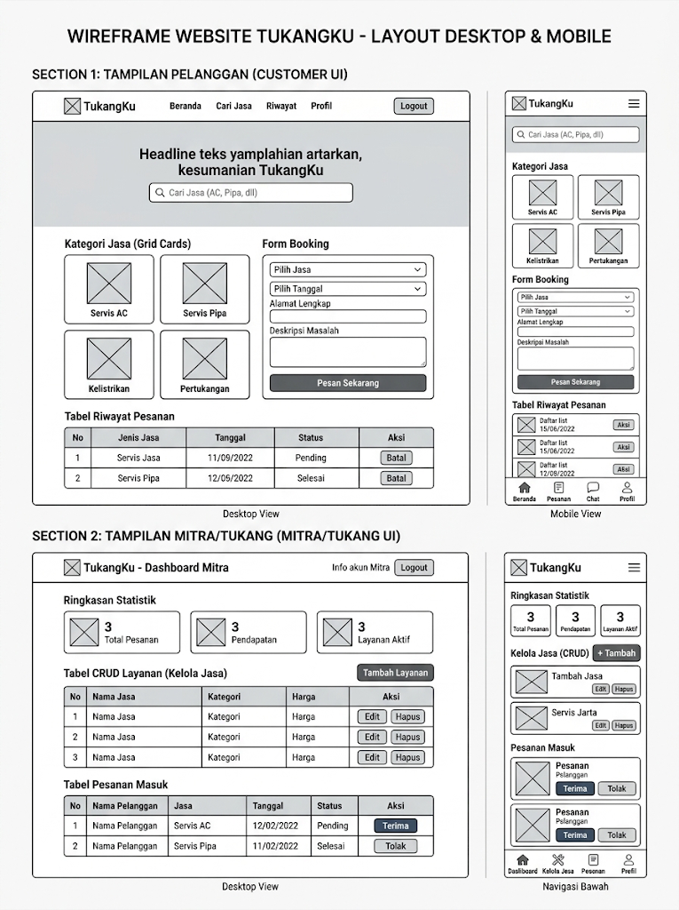

# TukangKu – Platform Digital Pemesanan Layanan Jasa & Servis Lokal

> **Tugas Akhir Mata Kuliah**: IF220603 Pemrograman Web  
> **Dosen Master**: Edison ST, MKOM  
> **Teknologi**: Native Full-Stack (HTML5, CSS3, JavaScript, PHP, MySQL)

---

## 📌 Daftar Isi
1. [Tentang Proyek](#-tentang-proyek)
2. [Anggota Kelompok & Peran](#-anggota-kelompok--peran)
3. [Latar Belakang & Tujuan](#-latar-belakang--tujuan)
4. [Teknologi yang Digunakan](#-teknologi-yang-digunakan)
5. [Spesifikasi Fitur Utama & Keamanan](#-spesifikasi-fitur-utama--keamanan)
6. [Perancangan Database (MySQL)](#-perancangan-database-mysql)
7. [Sitemap (Struktur Halaman Web)](#-sitemap-struktur-halaman-web)
8. [Storyboard (Alur Interaksi Pengguna)](#-storyboard-alur-interaksi-pengguna)
9. [Wireframe & Rancangan Antarmuka](#-wireframe--rancangan-antarmuka)
10. [Rekomendasi Struktur Direktori](#-rekomendasi-struktur-direktori)
11. [Panduan Instalasi & Menjalankan Proyek](#-panduan-instalasi--menjalankan-proyek)

---

## 📖 Tentang Proyek
**TukangKu** adalah platform digital berbasis web dinamis yang dirancang untuk mempertemukan pelanggan yang membutuhkan jasa perawatan serta perbaikan rumah (seperti servis AC, perbaikan pipa saluran air, instalasi kelistrikan, dan pertukangan umum) dengan mitra teknisi dan tukang lokal yang terpercaya secara cepat, transparan, dan terstruktur.

---

## 👥 Anggota Kelompok & Peran

| Nama Lengkap | NIM | Peran Utama | Tanggung Jawab Utama |
| :--- | :---: | :---: | :--- |
| **Aditya Pratama Hutomo** | `2510101017` | **Front-End Developer** | Membangun struktur HTML5 semantik, styling CSS responsif (desktop & mobile), serta interaktivitas client-side JavaScript (validasi form real-time & manipulasi DOM). |
| **Marchel Yosia Parlindungan Siahaan** | `2510101050` | **Back-End Developer** | Mengembangkan logika bisnis PHP, sistem autentikasi session/cookies, penanganan operasi CRUD, serta penerapan standar keamanan (*password hashing* & *prepared statement*). |
| **Alfio Acneilsen** | `2510101026` | **Database Designer & QA / Dokumentasi** | Merancang skema database MySQL (ERD & Relasi antar tabel), melakukan pengujian fungsionalitas sistem (Quality Assurance), serta menyusun laporan dan dokumentasi teknis proyek. |

---

## 🎯 Latar Belakang & Tujuan

### Latar Belakang
- **Kebutuhan Mendesak Pelanggan**: Masyarakat perkotaan maupun pemukiman padat sering kali kesulitan menemukan teknisi dan tukang yang tepercaya saat menghadapi kerusakan fasilitas rumah tangga (AC mati, kebocoran pipa, korsleting listrik). Pencarian konvensional memakan waktu, minim ulasan, serta tidak memiliki kepastian tarif.
- **Pemberdayaan Mitra Lokal**: Di sisi lain, para penyedia jasa dan teknisi lokal memiliki keterbatasan akses pemasaran digital, sehingga pangsa pasar mereka hanya terbatas pada lingkungan terdekat.
- **Solusi**: **TukangKu** hadir sebagai jembatan penghubung dua arah yang transparan, memudahkan pemesanan jasa bagi pelanggan dan memperluas peluang kerja mitra lokal.

### Tujuan Proyek
1. **Pengembangan Sistem Native**: Membangun aplikasi web *full-stack* interaktif berbasis **HTML5, CSS, JavaScript, PHP, dan MySQL murni (*native*)** tanpa ketergantungan pada framework eksternal besar.
2. **Kemudahan Akses Pelanggan**: Menyediakan antarmuka yang bersih dan responsif bagi pelanggan untuk menjelajahi katalog jasa, melakukan pemesanan (booking), dan memantau status pesanan secara *real-time*.
3. **Pemberdayaan Mitra Lokal**: Memfasilitasi mitra teknisi/tukang untuk mengelola portofolio jasa, menetapkan tarif layanan, serta merespons dan memperbarui status pesanan yang masuk secara mandiri.

---

## 🛠 Teknologi yang Digunakan

Proyek ini dibangun secara *native* tanpa framework CSS maupun framework backend eksternal:

| Layer | Teknologi | Deskripsi Penggunaan |
| :--- | :--- | :--- |
| **Frontend Structure** | `HTML5` | Struktur semantik dokumen web (`<header>`, `<nav>`, `<main>`, `<section>`, `<article>`, `<footer>`). |
| **Frontend Styling** | `CSS3` | Layouting responsif menggunakan Flexbox, CSS Grid, Media Queries, dan Custom Properties (CSS Variables). |
| **Client Scripting** | `JavaScript (Vanilla ES6+)` | Validasi form di sisi browser, interaktivitas antarmuka, toggle modal, dan manipulasi DOM dinamis. |
| **Backend Engine** | `PHP (Native 8.x)` | Pengolahan logika server, manajemen sesi/cookies, routing berkas, dan komunikasi basis data. |
| **Database** | `MySQL / MariaDB` | Penyimpanan data relasional (`users`, `services`, `orders`). |
| **Keamanan** | `Bcrypt & PDO / MySQLi` | Enkripsi kata sandi via `password_hash()` dan pencegahan injeksi SQL via *Prepared Statements*. |

---

## 🔐 Spesifikasi Fitur Utama & Keamanan

### 1. Autentikasi & Role-Based Access Control (RBAC)
- **Registrasi & Login**: Registrasi akun terpisah antara **Pelanggan** dan **Mitra/Tukang** dengan enkripsi password via `password_hash()` (algoritma Bcrypt) dan verifikasi via `password_verify()`.
- **Manajemen Sesi**: Penggunaan PHP Session dan Cookies yang aman untuk membatasi akses halaman sesuai peran pengguna (*Role-Based Access Control*).
- **Peran Sistem**:
  - `pelanggan`: Mencari jasa, melakukan pemesanan, melihat riwayat transaksi, dan membatalkan pesanan *pending*.
  - `mitra`: Mengelola katalog layanan jasa (CRUD), melihat pesanan masuk, serta memperbarui status pengerjaan (Terima/Tolak/Selesai).
  - `admin`: Pengawasan sistem dan manajemen data secara keseluruhan.

### 2. Operasi Inti Bisnis (CRUD)
- **Pelanggan**:
  - `Create`: Membuat pesanan baru (*booking form*) dengan menentukan tanggal dan lokasi.
  - `Read`: Menjelajah katalog jasa & memantau riwayat status pemesanan.
  - `Update/Delete`: Membatalkan pesanan yang belum diproses (*status pending*).
- **Mitra / Tukang**:
  - `Create`: Mendaftarkan paket layanan dan keahlian baru.
  - `Read`: Melihat daftar layanan aktif dan daftar pesanan masuk dari pelanggan.
  - `Update`: Mengedit tarif & deskripsi layanan, serta memperbarui status pesanan (`pending` $\rightarrow$ `diterima` $\rightarrow$ `selesai`).
  - `Delete`: Menghapus layanan yang sudah tidak ditawarkan.

### 3. Standar Keamanan Aplikasi
- **Anti-SQL Injection**: Menggunakan *Prepared Statements* dan *Parameter Binding* pada seluruh kueri database.
- **Validasi Dua Lapis (*Dual-Layer Validation*)**:
  - *Client-side*: Validasi instan format email, kecocokan kata sandi, dan kelengkapan kolom via JavaScript.
  - *Server-side*: Sanitasi input (pembersihan string, `htmlspecialchars()`, `trim()`, validasi tipe data) pada PHP sebelum diproses.
- **Session Protection**: Proteksi terhadap session hijacking melalui validasi status login dan *session regeneration*.

---

## 🗄 Perancangan Database (MySQL)

Database dirancang dengan skema relasional yang normal dan efisien:



### Rincian Struktur Tabel

#### 1. Tabel `users`
Menyimpan data akun dan autentikasi seluruh entitas pengguna.
| Nama Kolom | Tipe Data | Keterangan |
| :--- | :--- | :--- |
| `id_user` | `INT(11)` | Primary Key, Auto Increment |
| `nama` | `VARCHAR(100)` | Nama lengkap pengguna |
| `email` | `VARCHAR(100)` | Alamat email unik (*Unique Constraint*) |
| `password` | `VARCHAR(255)` | Hash kata sandi pengguna (`password_hash`) |
| `role` | `ENUM('pelanggan', 'mitra', 'admin')` | Hak akses peran pengguna |
| `created_at` | `TIMESTAMP` | Waktu pendaftaran akun (Default: CURRENT_TIMESTAMP) |

#### 2. Tabel `services`
Menyimpan daftar katalog layanan yang ditawarkan oleh mitra teknisi/tukang.
| Nama Kolom | Tipe Data | Keterangan |
| :--- | :--- | :--- |
| `id_service` | `INT(11)` | Primary Key, Auto Increment |
| `id_mitra` | `INT(11)` | Foreign Key $\rightarrow$ `users.id_user` |
| `nama_layanan` | `VARCHAR(150)` | Judul / nama jasa |
| `kategori` | `VARCHAR(50)` | Kategori jasa (misal: AC, Pipa, Kelistrikan, Pertukangan) |
| `harga` | `DECIMAL(10, 2)` | Tarif dasar layanan |
| `deskripsi` | `TEXT` | Rincian cakupan pekerjaan layanan |

#### 3. Tabel `orders`
Menyimpan riwayat dan transaksi pemesanan layanan oleh pelanggan.
| Nama Kolom | Tipe Data | Keterangan |
| :--- | :--- | :--- |
| `id_order` | `INT(11)` | Primary Key, Auto Increment |
| `id_pelanggan`| `INT(11)` | Foreign Key $\rightarrow$ `users.id_user` |
| `id_service` | `INT(11)` | Foreign Key $\rightarrow$ `services.id_service` |
| `tanggal_booking` | `DATE` | Tanggal pengerjaan yang diinginkan |
| `alamat_lokasi` | `TEXT` | Alamat lengkap lokasi pengerjaan |
| `status` | `ENUM('pending', 'diterima', 'selesai', 'dibatalkan')` | Status alur pengerjaan pesanan |
| `catatan` | `TEXT` | Instruksi atau keluhan tambahan dari pelanggan |

---

## 🗺 Sitemap (Struktur Halaman Web)

```text
[ Beranda / Landing Page ]
 │
 ├── Halaman Autentikasi
 │    ├── Login
 │    └── Register (Pilih Peran: Pelanggan / Mitra)
 │
 ├── [ Dashboard Pelanggan ]
 │    ├── Katalog & Pencarian Jasa (Filter Kategori)
 │    ├── Form Booking Layanan
 │    └── Riwayat Pesanan (Monitoring Status & Pembatalan)
 │
 ├── [ Dashboard Mitra / Tukang ]
 │    ├── Ringkasan Aktivitas (Statistik Transaksi, Pendapatan, Layanan Aktif)
 │    ├── Kelola Layanan (CRUD: Tambah, Lihat, Edit, Hapus Jasa)
 │    └── Kelola Pesanan Masuk (Konfirmasi Terima / Tolak & Selesaikan Order)
 │
 └── Logout (Pembersihan Sesi / Destroy Session)
```

---

## 🎬 Storyboard (Alur Interaksi Pengguna)

### Ringkasan 3 Skenario Utama:
1. **Alur Registrasi & Autentikasi Pengguna**:
   - Pengguna membuka form registrasi dan memilih tipe akun (Pelanggan atau Mitra).
   - Validasi input dilakukan di sisi browser menggunakan JavaScript (format email, kekuatan password, dan kesesuaian konfirmasi password).
   - Data dikirim ke backend PHP, diverifikasi dengan *prepared statements*, dan password di-hash sebelum disimpan ke tabel `users`.
   - Setelah login berhasil, session diinisialisasi dan diarahkan ke dashboard masing-masing peran.
2. **Alur Pemesanan Jasa (Pelanggan)**:
   - Pelanggan menelusuri katalog jasa berdasarkan kategori atau kotak pencarian.
   - Memilih jasa dan mengisi formulir booking (tanggal pengerjaan, alamat lengkap, dan catatan kendala).
   - Data tersimpan di tabel `orders` dengan status `pending` dan dapat dipantau pada halaman Riwayat Pesanan.
3. **Alur Pengelolaan Layanan & Pesanan (Mitra Tukang)**:
   - Mitra mengelola daftar jasa dan harga yang ditawarkan melalui modul Tambah/Edit Layanan.
   - Notifikasi order baru muncul di panel "Pesanan Masuk". Mitra dapat menerima order (status menjadi `diterima`) lalu menyelesaikannya setelah pengerjaan usai (status menjadi `selesai`).



---

## 📐 Wireframe & Rancangan Antarmuka

### 1. Halaman Registrasi & Login (Desktop)
Desain antarmuka otentikasi yang bersih, terfokus pada kemudahan input pengguna dengan validasi yang jelas.



### 2. Halaman Utama Pelanggan & Form Booking
Tampilan navigasi katalog jasa berbasis kartu (cards) dan formulir pemesanan yang ringkas.



### 3. Layout Responsif (Desktop & Mobile View)
Komparasi tata letak responsif untuk Dashboard Pelanggan dan Dashboard Mitra pada perangkat desktop maupun layar sentuh mobile.



---

## 📂 Rekomendasi Struktur Direktori

Struktur direktori berbasis pembagian modul (Frontend, Backend, Database):

```text
tukang-ku/
├── backend/                  # Logika server & API (PHP)
│   ├── config/               # Koneksi database & konfigurasi sistem
│   ├── modules/              # Modul autentikasi, pelanggan, mitra, admin
│   └── helpers/              # Fungsi bantuan, sanitasi input, middleware
├── frontend/                 # Antarmuka pengguna (HTML5, CSS3, JavaScript)
│   ├── assets/
│   │   ├── css/              # File stylesheet (style.css, auth.css, dashboard.css)
│   │   ├── js/               # File JavaScript (main.js, validation.js)
│   │   └── img/              # Asset gambar & ikon antarmuka
│   ├── views/                # Template / halaman tampilan antarmuka
│   └── components/           # Komponen reusable (header, footer, navbar)
├── database/                 # Skrip & perancangan basis data (MySQL)
│   └── database.sql          # DDL skema tabel & data awal
├── docs/                     # Dokumentasi proyek & aset proposal
│   └── img/                  # Diagram, storyboard, dan wireframe
├── index.php                 # Halaman utama / router entry point
└── README.md                 # Dokumentasi proyek
```

---

## 🚀 Panduan Instalasi & Menjalankan Proyek

### Prasyarat Sistem
- Web Server & PHP: **PHP 8.0 atau versi yang lebih baru**
- Basis Data: **MySQL 5.7+ / MariaDB 10.4+**
- Aplikasi Server Lokal yang direkomendasikan: **XAMPP**, **Laragon**, atau **PHP Built-in Server**

### Langkah-Langkah Menjalankan:

1. **Clone Repositori**:
   ```bash
   git clone https://github.com/naiko-oo/TukangKu.git
   cd TukangKu
   ```

2. **Setup Basis Data (MySQL)**:
   - Buka **phpMyAdmin** atau gunakan MySQL CLI.
   - Buat database baru bernama `tukangku_db`:
     ```sql
     CREATE DATABASE tukangku_db;
     ```
   - Impor skema tabel dari file `database/database.sql` ke dalam database `tukangku_db`.

3. **Konfigurasi Koneksi Database**:
   - Sesuaikan konfigurasi username dan password database pada file konfigurasi (misal: `config/database.php`):
     ```php
     <?php
     $host = 'localhost';
     $db   = 'tukangku_db';
     $user = 'root';
     $pass = '';
     $charset = 'utf8mb4';

     $dsn = "mysql:host=$host;dbname=$db;charset=$charset";
     try {
         $pdo = new PDO($dsn, $user, $pass, [
             PDO::ATTR_ERRMODE            => PDO::ERRMODE_EXCEPTION,
             PDO::ATTR_DEFAULT_FETCH_MODE => PDO::FETCH_ASSOC,
             PDO::ATTR_EMULATE_PREPARES   => false,
         ]);
     } catch (\PDOException $e) {
         throw new \PDOException($e->getMessage(), (int)$e->getCode());
     }
     ```

4. **Menjalankan Server**:
   - **Opsi A (Melalui XAMPP / Laragon)**: Pindahkan folder proyek ke dalam direktori `htdocs` (XAMPP) atau `www` (Laragon), lalu akses melalui browser:
     ```
     http://localhost/TukangKu
     ```
   - **Opsi B (Melalui PHP Built-in Server)**:
     Jalankan perintah berikut di root folder proyek:
     ```bash
     php -S localhost:8000
     ```
     Lalu buka peramban di `http://localhost:8000`.

---

## 📄 Lisensi & Hak Cipta
Proyek ini dikembangkan untuk keperluan akademik Tugas Akhir Mata Kuliah **Pemrograman Web (IF220603)**. Seluruh hak cipta dimiliki oleh tim pengembang **TukangKu**.
